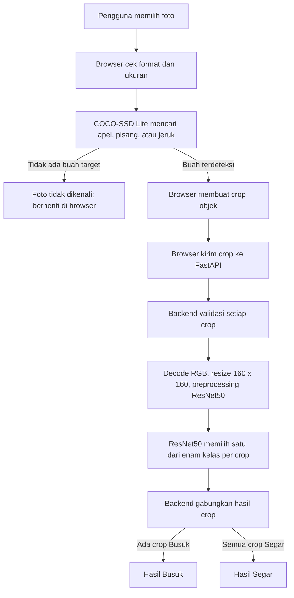

# Dokumentasi Proyek CekBuah

Dokumen ini menjelaskan CekBuah dengan bahasa sederhana dan tetap merujuk ke implementasi kode: apa tugas tiap model, bagaimana foto diproses, arti riwayat, peran berkas utama, dan cara menjalankan aplikasi.

## Ringkasan

CekBuah memeriksa foto apel, pisang, atau jeruk. Sistem memakai **dua model AI dengan tugas berbeda**: COCO-SSD Lite mencari objek buah di browser; ResNet50 menilai kondisi setiap potongan buah di backend.

Kalau COCO-SSD Lite tidak menemukan buah target, website menampilkan **Foto tidak dikenali** dan tidak mengirim foto ke backend ResNet50. Jika buah ditemukan, website mengirim potongan yang diperlukan ke backend. Hasil akhir menjadi **Busuk** jika ada setidaknya satu potongan yang ResNet50 prediksi busuk; jika semua potongan diprediksi segar, hasilnya **Segar**.

## Memahami model AI dan kode aplikasi

| Bagian | Tugas | Yang tidak dikerjakan |
| --- | --- | --- |
| **COCO-SSD Lite** (`lite_mobilenet_v2`) | Model deteksi objek yang berjalan di browser. Sistem hanya memakai hasil deteksi berkelas `apple`, `banana`, atau `orange`, beserta kotak lokasi buahnya. | Tidak menentukan segar atau busuk. |
| **ResNet50** (`ResNet50_terbaik.keras`) | Model klasifikasi yang berjalan di backend. Untuk tiap potongan, model memilih satu dari enam kelas: apel/pisang/jeruk segar atau busuk. | Tidak memeriksa apakah seluruh foto asal merupakan foto buah. |
| **Kode website dan backend** | Memeriksa format/ukuran foto, membuat crop, menyiapkan input, memuat model, mencatat tahap, dan menggabungkan hasil crop. | Bukan model AI dan tidak mengenali kondisi visual sendiri. |

Istilah **Lite** merujuk ke varian detektor yang dipakai agar deteksi bisa berjalan di browser. Pada pemakaian pertama, browser memuat bobot model detektor; foto tetap diproses di browser dan tidak diunggah ke layanan COCO. Angka batas deteksi `0,5` di kode adalah ambang internal untuk menerima deteksi COCO; itu **bukan** angka akurasi ResNet50 dan tidak ditampilkan sebagai persentase ke pengguna.

Label untuk setiap crop datang langsung dari `argmax` ResNet50; tidak ada ambang confidence tambahan untuk mengubah label crop. Ada keputusan aplikasi untuk foto dengan beberapa crop: satu foto pisang dibagi menjadi tiga crop tumpang-tindih, lalu aplikasi menetapkan hasil keseluruhan **Busuk** jika ada satu crop yang diprediksi busuk. Keputusan penggabungan ini dibuat oleh kode `decision_policy.py`, bukan dipelajari model dari notebook.

## Alur foto dari awal sampai hasil



### Langkah yang terjadi

1. **Pilih foto.** Browser menerima JPEG, PNG, atau WebP sampai 4 MB dan menampilkan pratinjau. Foto asli belum dikirim ke ResNet50.
2. **Deteksi jenis objek.** COCO-SSD Lite memeriksa foto di browser. Yang dipakai hanya kotak objek `apple`, `banana`, dan `orange`; objek kelas lain diabaikan. Jika tidak ada buah target terdeteksi, website menampilkan **Foto tidak dikenali** dan alur backend tidak dijalankan.
3. **Buat crop.** Apel dan jeruk mendapat satu crop untuk setiap objek terdeteksi. Kotak pisang dibagi menjadi tiga bagian yang saling tumpang-tindih sepanjang sisi kotak yang lebih panjang. Crop disiapkan sebagai JPEG; foto pisang campuran yang kamu berikan menghasilkan tiga crop di production.
4. **Kirim ke backend.** Frontend mengirim crop melalui `POST /api/v1/predict/stream`, dalam field multipart bernama `files`. Batas aplikasi adalah maksimal empat objek terdeteksi dan dua belas crop per request.
5. **Validasi backend.** FastAPI memeriksa bahwa tiap crop dapat dibaca, berformat JPEG/PNG/WebP, maksimal 4 MB per file, dan tidak lebih dari 20 megapiksel. Batas total request adalah 4,5 MB.
6. **Preprocessing.** Backend decode gambar menjadi RGB, resize ke `160 × 160`, ubah ke float32, lalu memakai `tf.keras.applications.resnet50.preprocess_input`. Urutan ini disamakan dengan pipeline notebook.
7. **Siapkan dan jalankan ResNet50.** Backend memeriksa SHA-256 artefak model terhadap manifest, memuat model jika belum ada di proses tersebut, lalu menjalankan inference untuk setiap crop. Output model berisi enam skor kelas; aplikasi tidak menampilkan skor tersebut sebagai persentase.
8. **Pilih label tiap crop.** `argmax` memilih kelas dengan skor tertinggi untuk crop itu. Indeks 0–2 berarti kelas segar; 3–5 berarti kelas busuk.
9. **Gabungkan label.** Jika satu crop saja busuk, hasil foto **Busuk**. Jika semua crop segar, hasil **Segar**. Nama buah berasal dari kelas ResNet50; jika prediksi crop berbeda jenis buah, nama gabungannya bisa tampil sebagai **Campuran**.
10. **Tampilkan hasil dan riwayat.** Frontend menampilkan hasil, versi model, dan langkah yang benar-benar dijalankan. Foto tidak disimpan ke database atau disk aplikasi.

### Apa arti riwayat proses

Urutan normal untuk foto yang berisi buah adalah:

1. **Deteksi buah** — proses COCO-SSD Lite di browser; durasinya diukur browser.
2. **Validasi format dan ukuran foto** — validasi crop di backend.
3. **Preprocessing ResNet50** — persiapan semua crop ke ukuran dan format tensor model.
4. **Menyiapkan model ResNet50** — hash diperiksa dan model siap dipakai. Model dimuat sekali per proses backend dan bisa dipakai kembali.
5. **Inferensi ResNet50** — model memeriksa tiap crop.
6. **Agregasi hasil** — kode aplikasi menggabungkan label crop menjadi hasil foto.

Kalau detektor tidak menemukan buah target, riwayat hanya menampilkan tahap deteksi karena backend memang tidak dipanggil. Durasi tahap backend berasal dari event yang dikirim backend; tahap cepat ditahan di layar minimal 240 ms supaya terbaca. Penahanan visual ini tidak mengubah durasi yang dicatat.

## Hasil pengujian terakhir

Pada deployment Vercel aktif, foto non-buah yang diberikan menghasilkan **Foto tidak dikenali** tanpa error browser. Foto pisang yang sebagian busuk menghasilkan tiga crop dan keputusan ResNet50 **Busuk — Pisang**. Keenam tahap riwayat tampil; `/api/health` melaporkan ResNet50 siap. Pemeriksaan ini dilakukan pada 21 November 2026 untuk commit `7fed7e7`. Ini membuktikan sampel tersebut diproses seperti yang dimaksud, tetapi tidak membuktikan akurasi 100% untuk semua foto baru.

Demo: [klasifikasibuah.vercel.app](https://klasifikasibuah.vercel.app). Gunakan alamat yang berakhiran `buah`; alamat tanpa huruf `h` menghasilkan 404.

## Struktur dan Tanggung Jawab Berkas

### Frontend

| Berkas | Tanggung jawab |
| --- | --- |
| `frontend/index.html` | Metadata halaman, warna browser, favicon, dan mount point React. |
| `frontend/src/main.tsx` | Membuat root React dan memasang `App` serta stylesheet global. |
| `frontend/src/App.tsx` | Upload dan preview foto, validasi sisi klien, gerbang deteksi buah, permintaan SSE, riwayat proses, hasil, dan error. |
| `frontend/src/fruitDetector.ts` | Memuat COCO-SSD Lite di browser, mendeteksi tiga buah target, memotong tiap objek, dan membagi kotak pisang menjadi tiga slice tumpang-tindih. |
| `frontend/src/styles.css` | Token warna, tipografi, background orb, layout responsif, status hasil, dan animasi. |
| `frontend/src/vite-env.d.ts` | Deklarasi tipe frontend Vite dan impor CSS. |
| `frontend/public/favicon.svg` | Ikon tab browser yang memakai bentuk Lucide `ShoppingBasket`, sama dengan ikon header CekBuah. |
| `frontend/public/cekbuah-orb.svg` | Ilustrasi orb kaca, sorot lavender, garis orbit, dan flare untuk background hero. |
| `frontend/vite.config.ts` | Plugin React/Tailwind dan proxy `/api` untuk development lokal. |
| `frontend/package.json` | Dependensi dan perintah frontend, termasuk TensorFlow.js dan COCO-SSD untuk deteksi browser. |
| `frontend/package-lock.json` | Versi dependensi frontend yang dikunci oleh npm. |
| `frontend/tsconfig.json` | Referensi konfigurasi TypeScript frontend. |
| `frontend/tsconfig.app.json` | Pemeriksaan TypeScript untuk aplikasi React. |
| `frontend/tsconfig.node.json` | Pemeriksaan TypeScript untuk konfigurasi Vite. |

### Backend dan model

| Berkas | Tanggung jawab |
| --- | --- |
| `backend/main.py` | Entry point FastAPI untuk runtime Vercel. |
| `backend/app/__init__.py` | Penanda package aplikasi backend. |
| `backend/app/api.py` | Endpoint health/model info/prediksi, validasi request dan gambar, serta SSE tahapan dan hasil. |
| `backend/app/preprocessing.py` | Decode RGB, resize 160×160, konversi float32, dan preprocessing ResNet50. |
| `backend/app/model_loader.py` | Memeriksa hash, memuat model satu kali per proses, dan menjalankan inference. |
| `backend/app/decision_policy.py` | Memilih kelas ResNet50 per potongan dengan `argmax`, lalu menggabungkan hasil; Busuk menang jika ada satu potongan busuk. |
| `backend/model/ResNet50_terbaik.keras` | Satu-satunya artefak model yang digunakan website. |
| `backend/model/model_manifest.json` | Sumber nilai hash, kelas, ukuran input, versi, preprocessing, dan catatan evaluasi model. JSON dipertahankan tanpa komentar agar valid. |
| `backend/requirements.txt` | Dependensi Python runtime FastAPI, Pillow, multipart, TensorFlow, dan Uvicorn. |
| `backend/tests/test_preprocessing.py` | Pemeriksaan preprocessing format JPEG/PNG/WebP dan nilai RGB ResNet50. |
| `backend/tests/test_decision_policy.py` | Pemeriksaan pemetaan enam kelas, agregasi beberapa potongan, tie, dan output skor invalid. |

### Root dan deployment

| Berkas | Tanggung jawab |
| --- | --- |
| `vercel.json` | Definisi layanan frontend/backend Vercel dan rewrite `/api/*`; JSON tidak mendukung komentar. |
| `README.md` | Petunjuk ringkas menjalankan dan deploy aplikasi. |
| `dokumentasi.md` | Peta berkas, workflow klasifikasi, kecocokan notebook, endpoint, dan catatan model. |
| `PRODUCT.md` | Batasan dan tujuan produk demo. |
| `PLAN.md` | Rencana build, keputusan teknis, serta status kesiapan deploy. |
| `DESIGN.md` | Sistem visual, token, layout, komponen, dan aksesibilitas. |
| `.impeccable/cekbuah-surface.md` | Arah desain dan batasan konten untuk halaman CekBuah. |
| `.impeccable/cekbuah-quality-bar.md` | Kriteria visual yang berasal dari referensi pengguna. |
| `.impeccable/design.json` | Sidecar desain untuk editor/tooling; JSON tidak mendukung komentar. |
| `.gitignore` | Mengabaikan hasil build, cache, environment, dan file data lokal. |

File JSON dan model biner tidak diberi komentar di dalamnya karena akan merusak formatnya; fungsi file tersebut dicatat di tabel ini. Berkas kode Python, TypeScript/TSX, CSS, HTML, SVG, dan daftar dependensi memiliki komentar atau docstring pembuka.

## Kecocokan dengan Notebook

Notebook yang diperiksa adalah salinan lokal `outputs/UAS_Buah_Cepat_Resume.ipynb`, sesuai judul pada screenshot. Notebook Colab yang dibagikan pengguna ada di [tautan ini](https://colab.research.google.com/drive/16t9E0vxdy2ZF-86ZbjetxU_yVwtDOmON?usp=sharing). Link Colab tidak dapat dibaca langsung oleh pemeriksa web, sehingga perbandingan dilakukan pada salinan notebook lokal.

| Operasi | Notebook | Website | Cocok? |
| --- | --- | --- | --- |
| Urutan kelas | `freshapples`, `freshbanana`, `freshoranges`, `rottenapples`, `rottenbanana`, `rottenoranges` | Urutan yang sama di `model_manifest.json` dan `decision_policy.py` | Ya |
| Decode | `tf.io.decode_image(..., channels=3, expand_animations=False)` | `prepare_image()` memakai parameter yang sama | Ya |
| Resize | `tf.image.resize(image, (160, 160))` | Bilinear, antialias off; sama dengan default notebook | Ya |
| Input preprocessing | `tf.keras.applications.resnet50.preprocess_input(x)` sesudah float32 RGB 0–255 | Pemanggilan yang sama pada tensor resize | Ya |
| Model | ImageNet ResNet50 dibekukan, Global Average Pooling, Dropout 0.3, Dense 6 softmax | Model tersimpan dijalankan dengan `training=False`; lapisan berada di dalam artefak yang sama | Ya |
| Keputusan per bagian | `np.argmax(probability, axis=1)` | `np.argmax()` di `decision_policy.py` untuk setiap potongan | Ya |
| Deteksi objek dan pemotongan | Tidak ada pada notebook | COCO-SSD mendeteksi lalu memotong objek apel/pisang/jeruk di browser | Tahap tambahan website |
| Agregasi kondisi | Tidak ada pada notebook; satu gambar mempunyai satu label | Busuk jika satu atau lebih potongan terdeteksi Busuk | Aturan hasil website |
| Augmentasi | Flip dan perubahan brightness hanya pada dataset training | Tidak diterapkan saat prediksi foto website | Benar; augmentasi training tidak boleh dijalankan pada inference |

Transformasi tensor, model, urutan kelas, dan argmax per potongan tetap mengikuti notebook. Deteksi/pemotongan COCO-SSD, slice pisang, dan aturan agregasi beberapa objek adalah tahap tambahan website, bukan bagian dari notebook training. Input inference berupa crop, sehingga hasilnya dapat berbeda dari klasifikasi satu gambar penuh di notebook.

### Arti tahap di riwayat

1. **Deteksi apel, pisang, atau jeruk** — COCO-SSD Lite mendeteksi objek buah di browser. Kotak pisang dibagi menjadi tiga slice tumpang-tindih; apel dan jeruk memakai satu crop per objek. Tahap ini berjalan sebelum upload ke backend.
2. **Validasi format dan ukuran foto** — backend memeriksa setiap potongan; batas request body tetap berlaku.
3. **Preprocessing ResNet50 · tiap bagian · 160 × 160** — decode, resize bilinear, float32, dan `preprocess_input` dijalankan untuk tiap potongan.
4. **Menyiapkan model ResNet50** — memastikan artefak terverifikasi dan siap; model dimuat malas sekali per proses, lalu dipakai ulang.
5. **Inferensi ResNet50 · tiap bagian buah** — forward pass enam kelas untuk setiap objek yang terdeteksi.
6. **Agregasi hasil** — jika satu potongan diprediksi Busuk, hasil keseluruhan menjadi Busuk; jika semua diprediksi Segar, hasil menjadi Segar.

Backend mengirim event `running` dan `complete` ketika masuk/keluar dari tiap kelompok tahap. Frontend menampilkan event secara berurutan dan menahan status berjalan minimal 240 ms agar langkah yang sangat cepat tetap terlihat. Angka durasi di setiap baris tetap durasi terukur backend; jeda UI tidak mengubah waktu yang ditampilkan atau hasil model.

### Pemetaan kelas

| Indeks | Kelas notebook | Hasil UI |
| ---: | --- | --- |
| 0 | `freshapples` | Segar · Apel |
| 1 | `freshbanana` | Segar · Pisang |
| 2 | `freshoranges` | Segar · Jeruk |
| 3 | `rottenapples` | Busuk · Apel |
| 4 | `rottenbanana` | Busuk · Pisang |
| 5 | `rottenoranges` | Busuk · Jeruk |

## Alur Workflow Klasifikasi

```text
Pilih foto
  → frontend/src/App.tsx: cek tipe/ukuran dan tampilkan preview
  → frontend/src/fruitDetector.ts: COCO-SSD Lite deteksi apel/pisang/jeruk di browser
  → jika tidak ada objek target: tampilkan Foto tidak dikenali, backend tidak dipanggil
  → jika ada: potong setiap objek dan POST /api/v1/predict/stream dengan multipart `files`
  → backend/app/api.py: validasi semua potongan
  → backend/app/preprocessing.py: decode RGB → resize 160×160 → float32 → ResNet50 preprocess_input per potongan
  → backend/app/model_loader.py: cocokkan SHA-256, muat/cache ResNet50, jalankan inference per potongan
  → backend/app/decision_policy.py: argmax tiap potongan → Busuk menang bila ada satu potongan busuk
  → backend/app/api.py: kirim event SSE tiap tahap dan hasil gabungan
  → frontend/src/App.tsx: tampilkan riwayat terurut dan hasil akhir
```

Semua event dan hasil hanya berlaku untuk request saat itu. Foto tidak ditulis ke disk atau database.

## API

| Method | Path | Fungsi |
| --- | --- | --- |
| `GET` | `/api/health` | Memastikan model dapat dimuat. |
| `GET` | `/api/v1/model-info` | Menampilkan arsitektur, versi, kelas, ukuran input, metode keputusan, dan konfigurasi gerbang buah. |
| `POST` | `/api/v1/predict/stream` | Prediksi dan event proses melalui SSE; menerima satu `file` atau beberapa `files`, digunakan UI. |
| `POST` | `/api/v1/predict` | Prediksi JSON tanpa riwayat SSE. |

Foto dibatasi JPEG/PNG/WebP sampai 4 MB. API juga menolak gambar tidak valid atau lebih dari 20 megapiksel.

Website memakai endpoint `/api/v1/predict/stream`. Endpoint `/api/v1/predict` adalah endpoint langsung untuk satu gambar: ia menjalankan preprocessing dan ResNet50, tetapi tidak menjalankan gerbang COCO-SSD Lite di browser atau pemotongan pisang. Karena itu, gunakan alur UI website untuk mendapat pemeriksaan buah/non-buah yang sama dengan demo.

## Menjalankan Lokal

Backend:

```powershell
python -m venv .venv
.venv\Scripts\Activate.ps1
python -m pip install -r backend\requirements.txt
Set-Location backend
python -m uvicorn main:app --reload --port 8000
```

Frontend di terminal lain:

```powershell
Set-Location frontend
npm install
npm run dev
```

Frontend meneruskan `/api/*` ke `http://127.0.0.1:8000`. Build produksi frontend:

```powershell
npm run build
```

## Deploy Vercel

Demo saat ini aktif di [klasifikasibuah.vercel.app](https://klasifikasibuah.vercel.app). `vercel.json` mengarahkan frontend Vite dan backend FastAPI serta meneruskan `/api/*`. Pada pemeriksaan terakhir, deployment berhasil dan `/api/health` mengembalikan status siap. Batas upload aplikasi adalah 4 MB per foto; periksa status deployment dan health endpoint setelah perubahan berikutnya.

## Catatan Evaluasi dan Batasan

Pada evaluasi test notebook, 31 dari 1.548 gambar busuk terprediksi segar oleh `argmax` mentah. COCO-SSD Lite adalah detektor objek umum dengan 80 kelas, termasuk apple, banana, dan orange; detektor ini membuat gerbang foto bukan-buah, tetapi tetap dapat luput pada gambar buram, tertutup, atau jauh. ResNet50 mengklasifikasikan setiap potongan secara visual dan dapat melewatkan bercak busuk lokal. Agregasi Busuk menang jika salah satu potongan yang terdeteksi diprediksi Busuk, tetapi sistem belum menjamin semua bagian busuk ditemukan atau hasil 100% pada foto baru.
